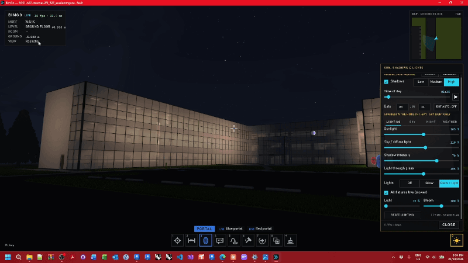

# BimGo — First-Person BIM Walkthroughs

BimGo turns a Revit model into an FPS-style, first-person walkthrough: collision, gravity, walkable stairs, a room readout and nine tool guns. It renders with its own small OpenGL engine (own renderer, window and input; GL function bindings from Silk.NET).

- **BimGo for Revit**: a slim add-in (extractor and session bridge). **Go** opens the model in the app as a *live session*: edits go straight back into Revit, Scan → R selects in Revit, and changes made in Revit prompt a refresh (F5). **Export .bimgo** writes a standalone file.
- **BimGo** (`BimGo.exe`): joins live sessions, or opens `.bimgo` files without Revit, keeping edits in the file's journal (undo / redo) to **push** into the Revit model later.

Publisher **Aussie BIM Guru** · licence **MIT No Attribution (MIT-0)**: use it for anything, no credit required, no warranty. Autodesk and Revit are registered trademarks of Autodesk, Inc.; BimGo is an independent project, not affiliated with, sponsored by or endorsed by Autodesk ("for Revit" describes compatibility only).

**Docs:** the **[user guide](docs/README.md)** (getting started, every tool, troubleshooting) · [controls](docs/controls.md) · [DEVELOPING.md](DEVELOPING.md) (architecture, file format, live protocol, conventions) · [HISTORY.md](HISTORY.md) (every build) · [releasing](docs/releasing.md) · `ai/` (each round's handoff and build notes) · [THIRD-PARTY-NOTICES.txt](THIRD-PARTY-NOTICES.txt).

## Features

- **Walk and fly** through the model (V: no-clip), level up / down, go home, bookmarks with thumbnails, find a room and go there, minimap, coordinate readout (shared / project / internal), eye-height presets (standing, seated, child).
- **Tool guns:** Scan (element info and parameters), Measure (distance, area, angle, clearance; saved), Portal, Comment, Teleport, Demolish, Gizmo (move / rotate), Clone, Place (family library and entourage).
- **Edits** made in the walkthrough: live into Revit (demolish in the new phase, delete, move, rotate, copy, place family types), or into the file's journal and pushed into Revit later (conflict checks, one undo in Revit).
- **Comments as issues:** status, priority, assignee, replies, saved view and picture, markup; BCF 2.1 export / import; one adaptive **comment marker** per comment placed in the Revit model.
- **Lighting:** sun and shadows from the model's site (time-of-day slider, location override), night sky with moon and stars, artificial lights from lighting fixtures with IES / Revit photometric profiles, ambient occlusion, bloom.
- **Realistic mode:** Revit materials and textures (missing images reconciled or replaced by CC0 proxies), reflection probes, sharp reflections in stills, water ripples, grass blades, rain, snow and lightning.
- **Lighting calculations** (TomKal1 fork): illuminance calculated in BimGo with the shared WWTools lighting engine, WW Tools results on the model, an isometric model review and calculated room images. See [lighting calculations](docs/lighting-calculations.md).
- **Studies:** direct sun hours, daylight factor and illuminance on a room's surfaces, pass / fail against a target, CSV export.
- **Review:** section box and plane with caps, colour profiles (by value, parameter ranges or search set), room data overlay with target checks, grids and levels with intersections, walkthrough-only hiding and isolating.
- **Clash detection:** search sets, hard and clearance tests, clash mode with a docked list, statuses across runs, groups, comments / BCF, HTML and XML reports.
- **Media:** photo mode (hi-res stills, 360° panoramas), bookmark tours, keyframed camera paths with a 3D editor, MP4 video, sun time-lapses, batch stills, entourage billboards (trees, people, cars; or Revit planting / entourage swapped for them).
- **Presentation:** **kiosk mode** (a desktop shortcut opens a saved model fullscreen for visitors: walk, fly and look only; an idle tour after two minutes; Ctrl+Shift+Q held to leave).
- **Controls:** every key rebindable (keyboard, mouse buttons, wheel), Xbox-style and generic gamepads, a context-sensitive F1 sheet, a gun wheel.
- **Linked models**, active-view-only extraction, phases (existing / new), metric or imperial units, quality profiles.

## Install

Download `BimGo-Setup-<version>.exe` from [Releases](https://github.com/aussieBIMguru/BimGo/releases) and run it: per user, no admin rights, BimGo for Revit 2025 / 2026 / 2027 included when Revit is found. Then in Revit: **BimGo → Go** (live) or **Export .bimgo**. See [Getting started](docs/getting-started.md).

## Build from source

1. Open `src/BimGo.sln` in Visual Studio 2022 (.NET desktop workload; the .NET 10 SDK too for Revit 2027). Configurations `Debug R25` / `R26` / `R27` (Revit 2025 / 2026 / 2027) or Release.
2. Build. **Debug** builds deploy like the installer: the app to `%LocalAppData%\Programs\BimGo\` (it registers `.bimgo` files and a Start-menu shortcut on start), the add-in into `%AppData%\Autodesk\ApplicationPlugins\BimGo.bundle\Contents\<year>\` (removing any older copy under `Revit\Addins\<year>\`). Release builds copy nothing.
3. Tests: Test Explorer → Run All, or `dotnet test tests/BimGo.Core.Tests`.
4. A release (tests, the self-contained app, the bundle and `BimGo-Setup-<version>.exe`): `build\publish.ps1`, see [releasing](docs/releasing.md). The version is set once, in `src/Directory.Build.props`.

**Command line** (`BimGo.exe`):

| Arguments | What it does |
|---|---|
| `model.bimgo` | Opens the file (a running BimGo takes it over and opens it when the current model closes) |
| `--kiosk model.bimgo` | Opens the file in kiosk mode (a running BimGo is only brought forward) |
| `--session <id>` | Joins a live Revit session (what Go runs; the id is the folder name under `%LocalAppData%\BimGo\Sessions`) |
| `--register` / `--unregister` [`--quiet`] | Adds or removes the `.bimgo` association and the Start-menu shortcut for the current user (the installer runs these) |
| `--safe`, or hold **Shift** while starting | Safe start: default settings and the Basic quality profile for this run, nothing saved |

## Controls

Every key, mouse button and wheel notch can be rebound (**Esc → CONTROLS**), and **F1** shows the keys for what you are doing. The defaults, the guns and the gamepad are in [docs/controls.md](docs/controls.md).

## Files and folders

| What | Where |
|---|---|
| App | `%LocalAppData%\Programs\BimGo\BimGo.exe` (per user, no admin) |
| Add-in | `%AppData%\Autodesk\ApplicationPlugins\BimGo.bundle\` (one folder per Revit year) |
| Settings | `%AppData%\BimGo\settings.json` (Options, display choices, key bindings) |
| Logs | `%LocalAppData%\BimGo\Logs\BimGo.App.log` · `BimGo.Revit.log` |
| Per-model data (live sessions) | `%LocalAppData%\BimGo\Models\<title>_<hash>\`: comments and their pictures, bookmarks, sun, visibility, camera paths, entourage, light profiles, measurements, clashes, texture choices, saved sun studies. Options → Player can mirror them beside the model so colleagues on a shared drive see each other's comments. |
| `.bimgo` files | Everything above travels inside the file instead. |
| Pictures, videos | `Pictures\BimGo`, `Videos\BimGo` |

## Known limitations

- Undo / redo are file-only (live: undo in Revit, then F5); a refresh is a full re-extract; one window walks one model.
- Linked models are read-only, top-level instances only, phases matched by name.
- Demolish removes hosted elements with their host. Push: moves and clones need a location point.
- Rendering: one glass layer for shadows; AO is screen-space; Realistic mode has no bump maps or cutouts; reflection probes are static captures; sharp reflections only in stills; the live view lights a limited number of fixtures with shadows (photos and videos light them all).
- Studies (sun hours, daylight, lux) are early design indicators, not compliance calculations.
- Clash detection: hard depth is an estimate, an element wholly inside another isn't reported, closed solids are assumed, 10,000 clashes per test.
- Video has no sound. Camera paths and glides fly through walls (the path editor marks where).
- Kiosk mode locks BimGo, not Windows (the Windows key, Alt+Tab and Task Manager still work).

The full list, by area, is in [DEVELOPING.md](DEVELOPING.md#known-limitations).
