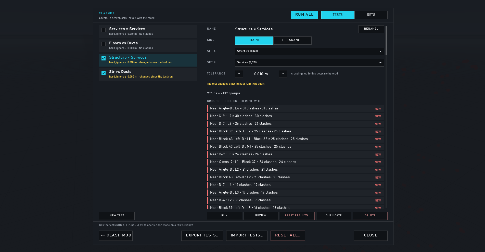
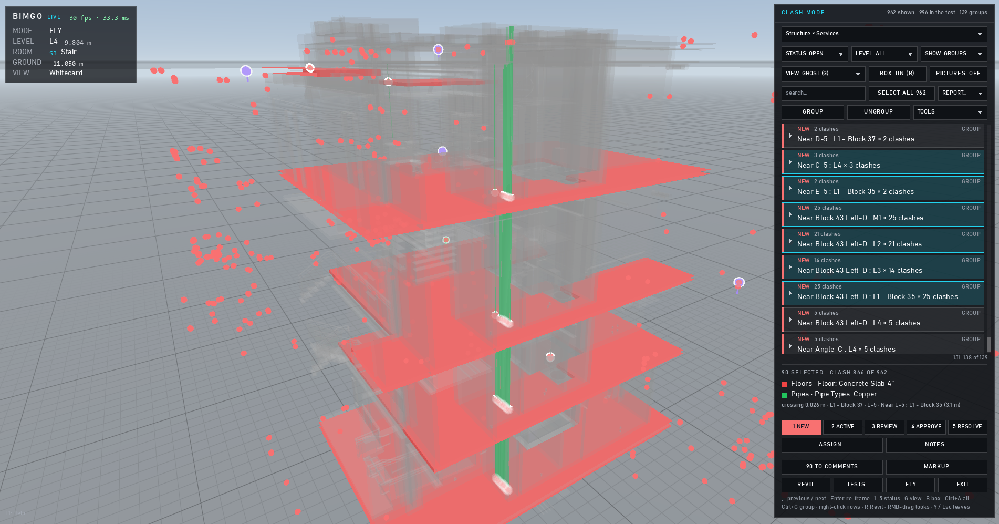
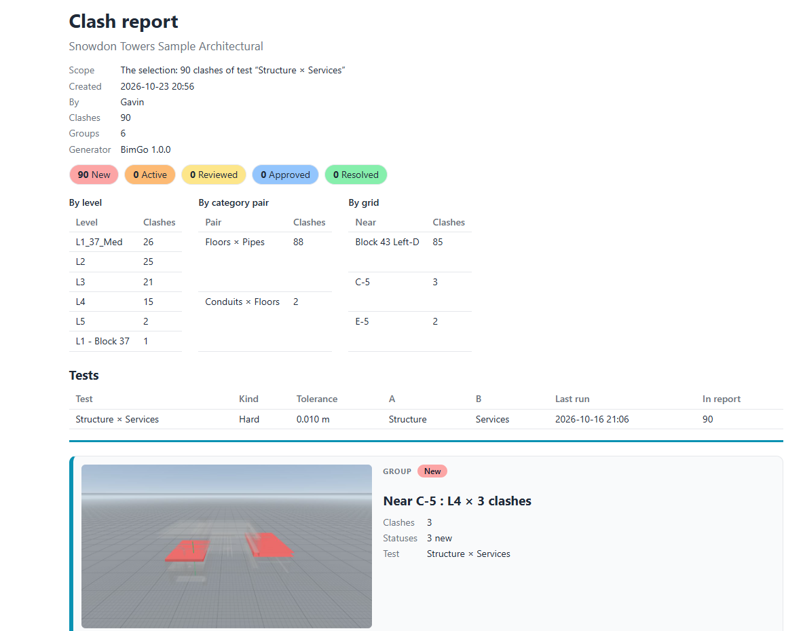

# Clash detection

← [Docs home](README.md)

Clash detection stays off until you use it: Esc → **CLASHES**, or **Y** for clash mode.

## Sets and tests

**SETS** are search sets: rules on category, family, type, level, phase, model or any extracted parameter (is, is one
of, contains, number ranges, and "not" rules that take elements out), in groups. **TESTS** run set A against set B (or
a set against itself) as **hard** clashes (crossing deeper than the tolerance) or **clearance** clashes (closer than a
distance). Tests and sets can be exported and imported to share between models.

## Reviewing

**Y** docks the clash list and frees the cursor (the move keys fly, right-drag looks). **.** and **,** step through
clashes: each gets a section box and a view across the pair. **1–5** set the status, **G** changes how the rest of the
model shows, **B** the section box, **R** shows the pair in Revit (live). Statuses carry over when you run a test again.

Clashes can be grouped (by element, level, category, grid, box or by hand), turned into comments (and so BCF), and
reported as an HTML page or Navisworks-style XML.

