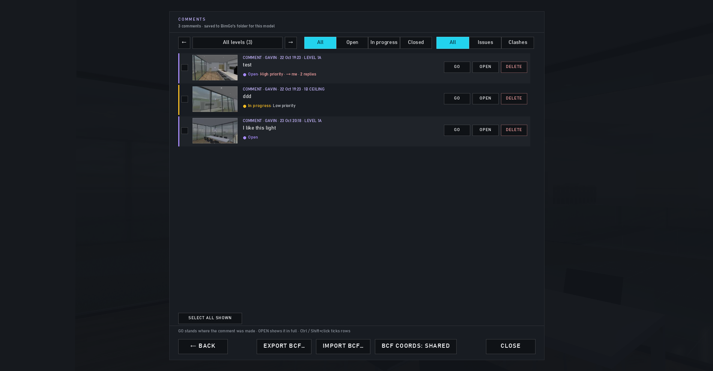
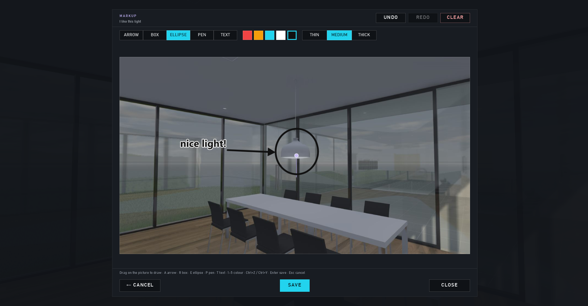
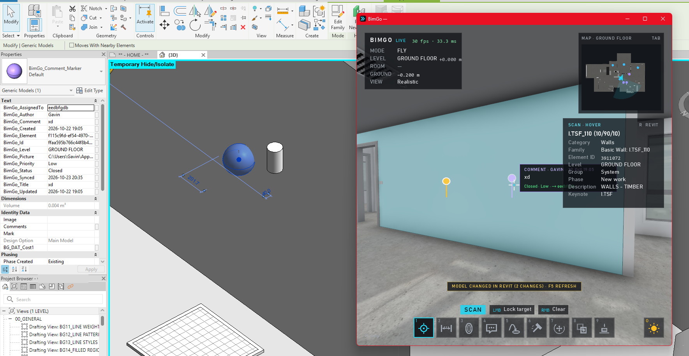

# Comments, markup and BCF

← [Docs home](README.md)

## Comments

The **Comment** gun (4) places a comment where you aim: type the text, Enter. Each comment keeps the view you made it
from and a picture. In COMMENTS (Esc) every comment is an issue with a **status** (open, in progress, closed),
**priority**, **assignee** and **replies**; filter by level and status, GO back to its view, OPEN for the details.

## Markup

Right after a comment's picture is taken (or MARKUP… in its details) you can draw on it: arrows, boxes, ellipses, pen
and text, five colours. SAVE burns it into the picture (the clean original is kept, so you can redo it).

## BCF

COMMENTS → **EXPORT BCF…** writes the comments shown as a BCF 2.1 file (with views, pictures, the element and any
section box) for other BIM tools. **IMPORT BCF…** reads BCF 2.0 / 2.1 / 3.0: known issues are updated, new ones become
comments. **BCF COORDS** picks shared (default), project or internal coordinates.

## In Revit

Comments can appear in the Revit model as markers: see [Live sessions](live-sessions.md#comment-markers-in-revit).

