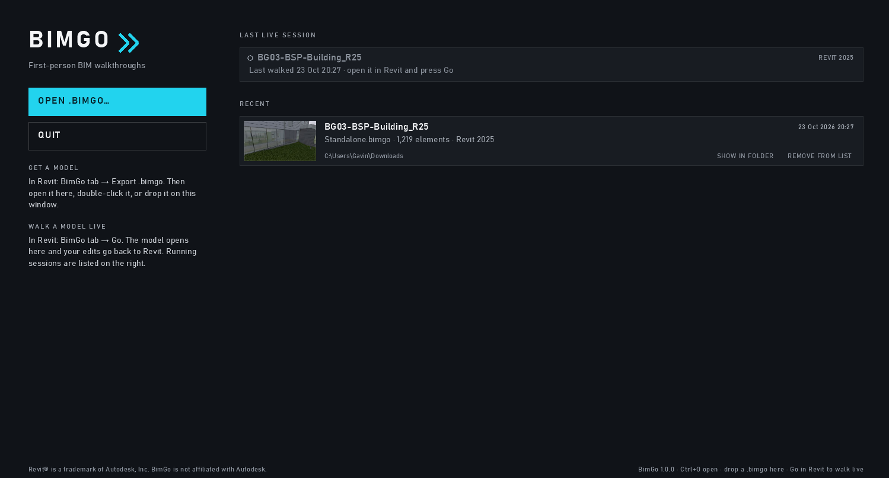

# Getting started

← [Docs home](README.md)

## Install

1. Download `BimGo-Setup-<version>.exe` from the [releases page](https://github.com/aussieBIMguru/BimGo/releases) and run
   it. No admin rights are needed: BimGo installs for your Windows user only.
2. Windows may show "Windows protected your PC" (the setup isn't code-signed yet): choose **More info → Run anyway**.
3. Pick **BimGo and BimGo for Revit** (offered when Revit 2025, 2026 or 2027 is installed), or **BimGo only** to open
   `.bimgo` files without Revit.
4. Close Revit and BimGo first if the setup asks.

The setup installs the app to `%LocalAppData%\Programs\BimGo`, registers `.bimgo` files and adds BimGo to the Start
menu. The first time Revit starts with BimGo for Revit, it may ask whether to load an add-in from an unverified
publisher: choose **Always Load**.

## Your first walkthrough from Revit

1. Open a model in Revit and go to the **BimGo** tab.
2. Click **Go**. The Options window opens: pick the **categories** to load (or *active view only*), the **existing and
   new phases**, any **linked models**, and whether to bring **materials and textures** (Realistic mode).
3. BimGo opens on the model. This is a **live session**: edits you make go straight into Revit, and changes you make
   in Revit offer a refresh (F5).

**Export .bimgo** on the same tab writes a standalone file instead: anyone with BimGo can open it, no Revit needed.

## Opening a file

Double-click a `.bimgo`, drag it onto the BimGo window, or use **Open** on the start screen. The start screen lists
recent files (with a picture of where you last were) and any live Revit sessions.

The first walkthrough shows a short welcome card with the main keys. Click **START WALKING** (or press Esc), then
click in the window to look around.

Next: [Moving around](moving-around.md).
