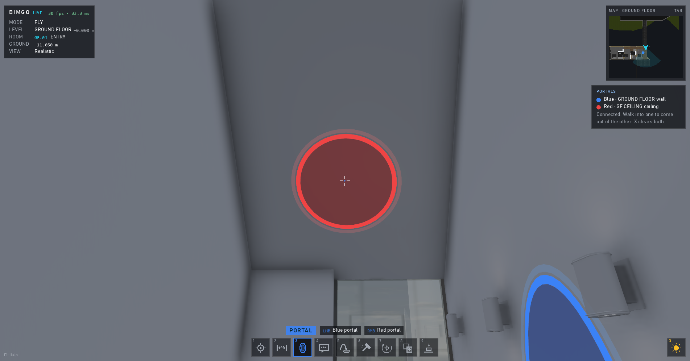
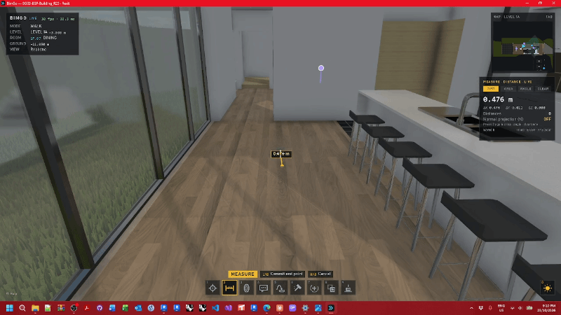
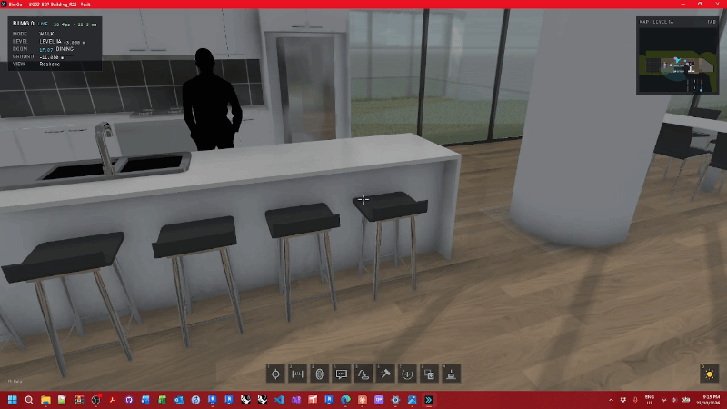
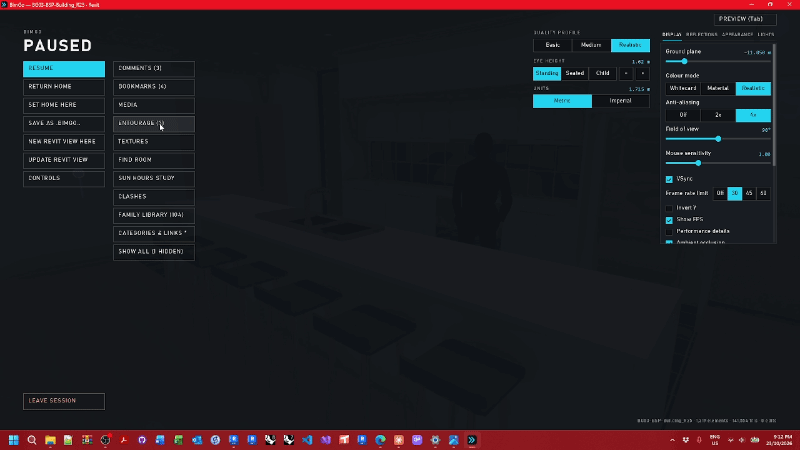

# The tool guns

← [Docs home](README.md)

Nine tools on keys **1–9** (or the gun wheel: hold the middle mouse button and steer). **0** puts the gun away. The
gun's panel (right) shows its mode and hints.

| # | Gun | Left click | Right click |
|---|---|---|---|
| 1 | **Scan**: element info and parameters; R selects it in Revit (live); I hides it, Shift+I isolates its category | Lock on | Clear |
| 2 | **Measure** (2 again: distance → area → angle → clearance) | Points | Close / undo the last |
| 3 | **Portal**: a pair of portals to step through | Blue portal | Red portal |
| 4 | **Comment**: an issue at the spot (see [Comments](comments-and-bcf.md)) | Place and type | Remove |
| 5 | **Teleport**: blink to where you aim | Blink | Step back |
| 6 | **Demolish** (T: demolish ↔ delete) | Prime, then demolish | Un-prime |
| 7 | **Gizmo**: move or rotate furniture and equipment | Lock on | Commit |
| 8 | **Clone**: copy an element in place, then move it | Clone | Commit |
| 9 | **Place**: family types from the library, or entourage billboards (the wheel switches) | Pick / remove | Place / commit |

## Moving elements (Gizmo, Clone, Place)

Once locked on, the move keys move it in plan, E / Q move it up and down, R switches move ↔ rotate, Z / X change the
snap step (G turns snapping off), **F** drops it onto the surface below. Right click commits, Esc cancels.

In a live session the edits happen in Revit (demolished in the new phase, moved, copied, placed). In a file they go
into its journal: undo / redo with Ctrl+Z / Ctrl+Y, and [push](live-sessions.md#push-a-files-edits-into-revit) them
into Revit later.

**Measurements** are saved with the model: I shows / hides them, E exports a CSV, X twice deletes them all.
