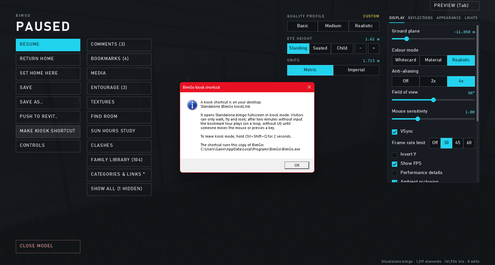
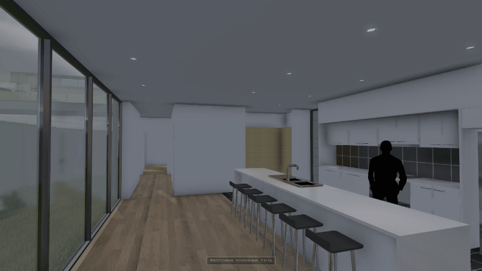

# Kiosk mode

← [Docs home](README.md)

For a model on a screen in a foyer or at a stand: visitors can walk, fly and look, and nothing else.

1. Open the model file, set up a few **bookmarks** (they become the idle tour) and save.
2. Esc → **MAKE KIOSK SHORTCUT**. A shortcut "<model> (BimGo kiosk)" appears on the desktop.
3. Double-click it: BimGo opens the file fullscreen in kiosk mode.

In kiosk mode:
- Only walking, flying and looking work: no menu, guns, panels or saving; Esc and Alt+F4 do nothing. A small hint shows
  the keys.
- After **two minutes** without input, the bookmark tour loops (or the view goes home if there are no bookmarks). Any
  key or mouse move takes over right where the tour is.
- **Hold Ctrl+Shift+Q for 2 seconds** to leave kiosk mode into the normal walkthrough.

Kiosk mode locks BimGo, not Windows: for a public PC, also use a Windows kiosk or guest account.
