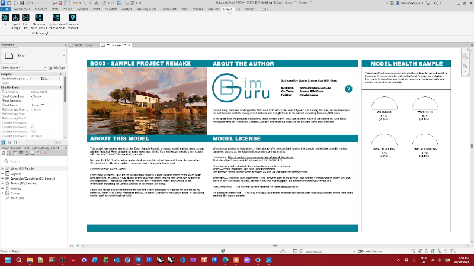
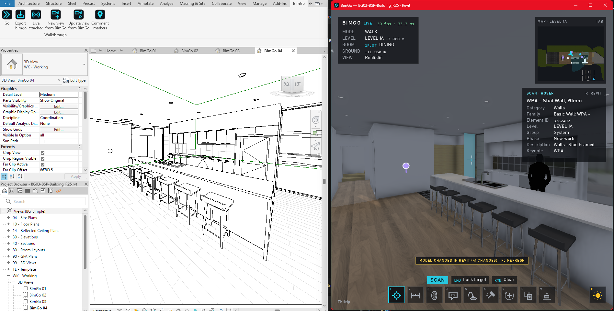
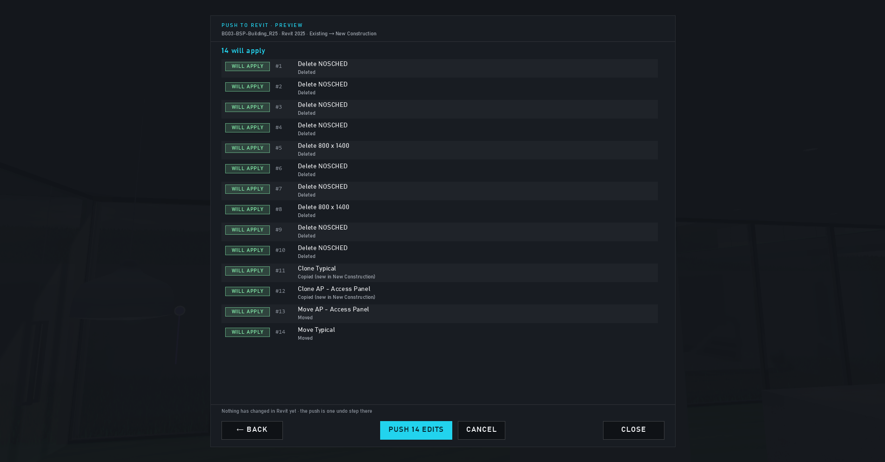

# Live sessions and Revit

← [Docs home](README.md)

## Go

**Go** on the BimGo tab extracts the model (with the Options you pick) and opens it in BimGo as a live session. While
it runs:
- Demolish, Gizmo, Clone and Place edits happen in Revit (one undo entry each in Revit).
- Scan → **R** selects the element in Revit.
- When the model changes in Revit, BimGo shows MODEL CHANGED: **F5** refreshes, keeping you where you stand.
- The ribbon's **Live** button shows the session, brings BimGo forward or ends it.

Comments, bookmarks, measurements and the other walkthrough data of a live session are kept per model in BimGo's own
folder (see [Settings and files](settings-and-files.md)), so they're there at the next Go.

## Revit views from BimGo

Esc → **NEW REVIT VIEW HERE** (Shift+F5) makes a perspective 3D view in Revit from where you stand;
**UPDATE REVIT VIEW** (Alt+F5) moves Revit's active perspective view there. The ribbon's buttons do the same.

## Comment markers in Revit

Each comment gets a **BimGo Comment Marker** in the model (a small adaptive family with status spheres and the
comment's details as parameters), kept in step during live sessions. The ribbon's **Comment markers** button syncs
them from the model's comments or a `.bimgo` file. A marker you delete in Revit stays deleted. Options → Player turns
live markers on or off and can remove closed ones.

## Push a file's edits into Revit

Edits made in a `.bimgo` file can go into the Revit model it came from: open the model in Revit and press Go, then in
BimGo open the file and choose Esc → **PUSH TO REVIT**. A dry run shows what would happen first. Elements that moved in
Revit since the export are reported as conflicts and skipped unless you say otherwise. The whole push is one undo in
Revit.

## Family library

With Options → Geometry → *Family library* ticked, Go also sends the family types loaded in the model, so the
**Place** gun can place new instances (level-based and work-plane-based types).
