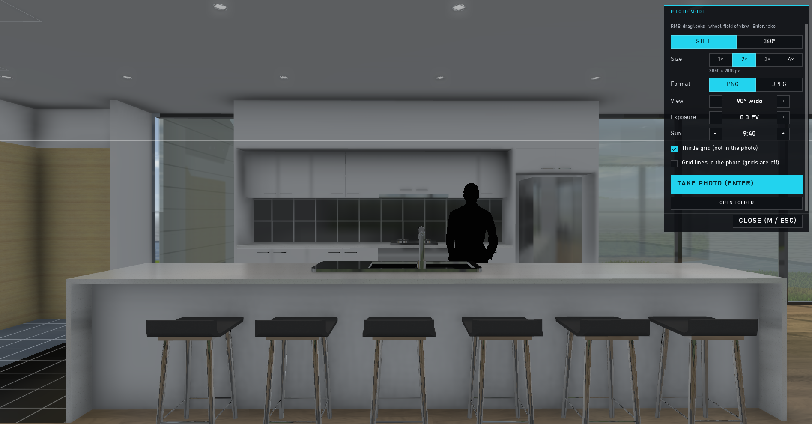
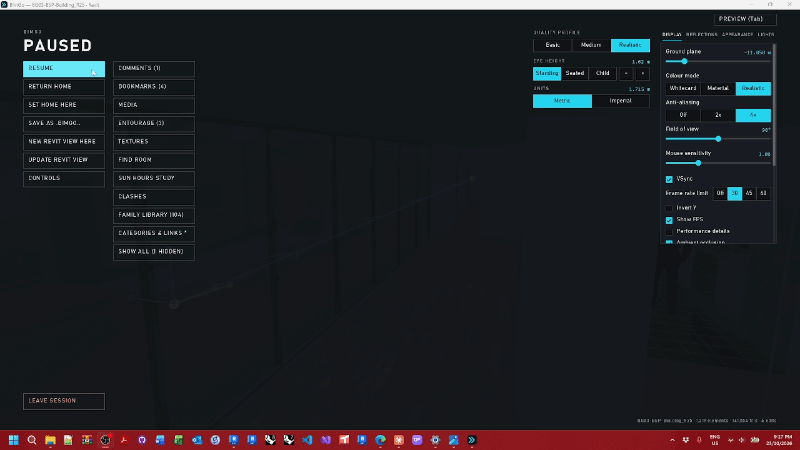
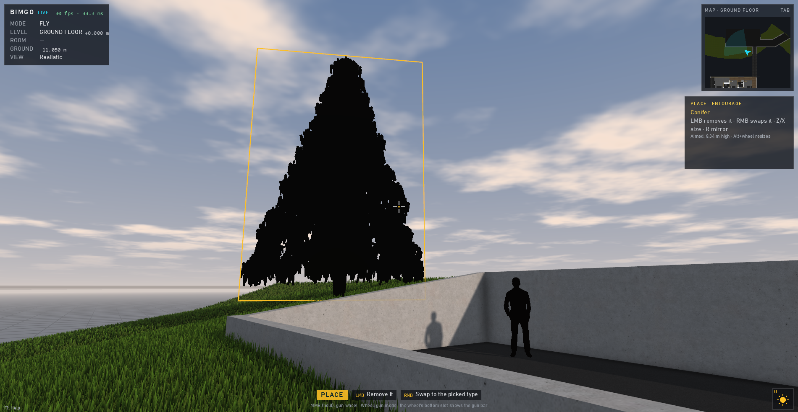

# Photos, tours, paths and video

← [Docs home](README.md)

**Shift+M** opens MEDIA: PHOTO · TOUR · PATHS · VIDEO. Pictures go to `Pictures\BimGo`, videos to `Videos\BimGo`.

## Photo mode

**M** frees the cursor for framing (right-drag looks, the wheel zooms): stills at up to 4× the window, or **360°
panoramas** that phones and panorama viewers recognise. Exposure, a thirds grid, the sun time. F12 takes a quick
screenshot any time.

## Bookmark tour

BOOKMARKS → PLAY TOUR plays your bookmarks in order: fade or glide between them, hold, a slow swivel, each stop with its
own sun, cuts and hidden things. Space pauses, ← → step, Esc stops. MEDIA → TOUR has the settings (and *Smooth*, which
flies a curve through the stops).

## Camera paths

MEDIA → PATHS → NEW PATH, then fly to each spot and ADD KEY HERE. Each key can hold, ease, look at a target or keep its
own view, and change the sun or colour profile. **Shift+K** opens the 3D path editor: the path is drawn in the model
(red where it hits something), drag handles, scrub along it, preview with Space.

## Video

MEDIA → VIDEO → RECORD VIDEO records the tour or a path to MP4 (window size, 1080p or 4K; 30 or 60 fps), always smooth
because it renders frame by frame. **Sun time-lapse** records one view from sunrise to sunset; **batch stills** (PHOTO
tab) renders every bookmark at a list of times.

## Entourage

Esc → ENTOURAGE (or the Place gun's entourage mode) plants trees, shrubs, people and cars as billboards, or your own
PNG cut-outs. Revit planting and entourage families can be swapped for billboards automatically.

