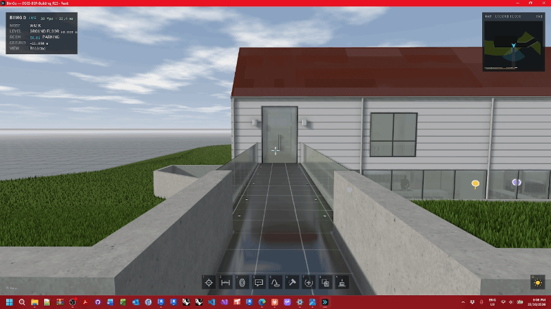
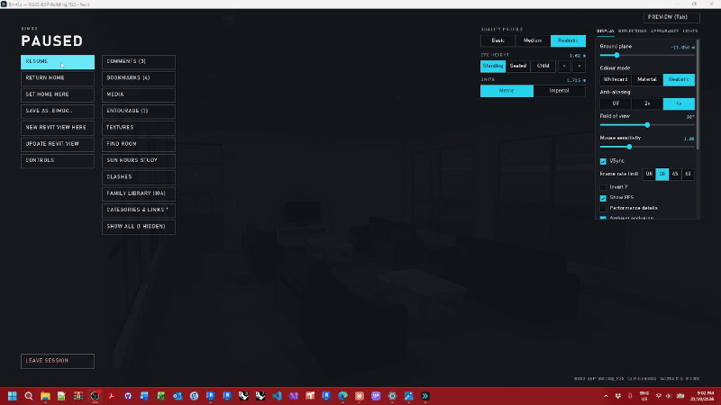
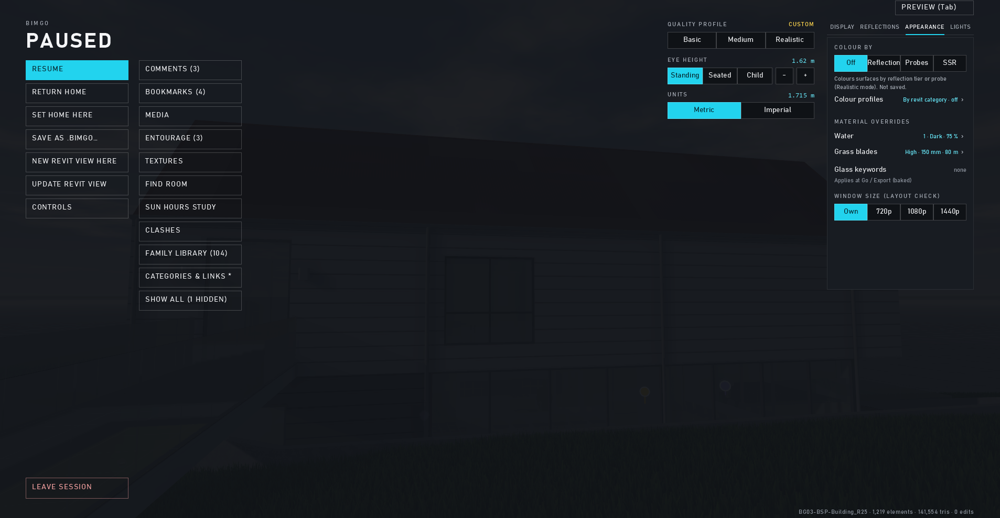

# Moving around

← [Docs home](README.md)

| Do this | Keys (default) |
|---|---|
| Walk | W A S D or the arrow keys; hold Shift to run |
| Look | move the mouse (click the window first to capture it) |
| Jump · crouch | Space · Ctrl |
| Fly (no-clip: through walls and floors) | V on / off; Space up, Ctrl down while flying |
| Level up / down | Page Up / Page Down |
| Go home · set home here | H · Shift+H |
| Bookmark this view · go to bookmark 1–9 | B · Shift+1–9 |
| Find a room | Ctrl+F |
| Minimap · hide the UI | Tab · U |
| Keys for what you're doing | F1 |
| Menu | Esc |

Doors are always open to walk through. Stairs and ramps are walkable. The status panel (top left) shows the level and
room you're in; **L** cycles a coordinate readout (shared, project or Revit internal coordinates).

**Eye height:** the pause menu has Standing, Seated and Child presets (each adjustable).

## The menu (Esc)

The left stack is the session: resume, return home, save, push edits into Revit, kiosk shortcut, CONTROLS, close the
model. The right stack is the review tools: comments, bookmarks, media, entourage, textures, find room, sun hours,
clashes, the family library, categories and links. Beside them are the display settings and quality profile.

## Bookmarks

**B** saves the view (with the sun time, the section box, what's hidden and the eye height). BOOKMARKS in the menu
lists them with pictures: go, rename, update, reorder, delete, or play them as a [tour](media.md#bookmark-tour).

## Gamepad

An Xbox-style controller works out of the box: move on the left stick, look on the right, triggers fire the guns,
Start opens the menu (in menus the right stick moves the cursor, A clicks, B goes back). Other controllers can be set
up in CONTROLS → MAP BUTTONS. See [Controls](controls.md).
