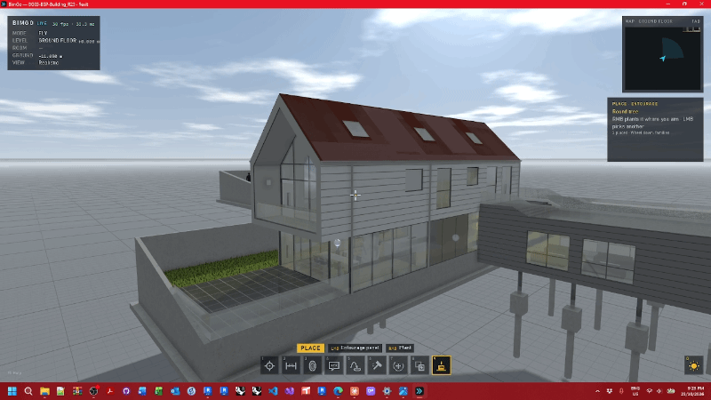
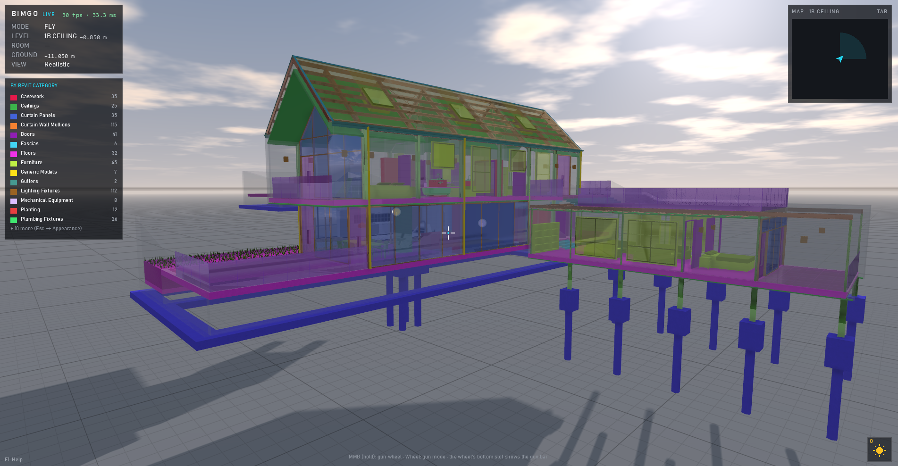
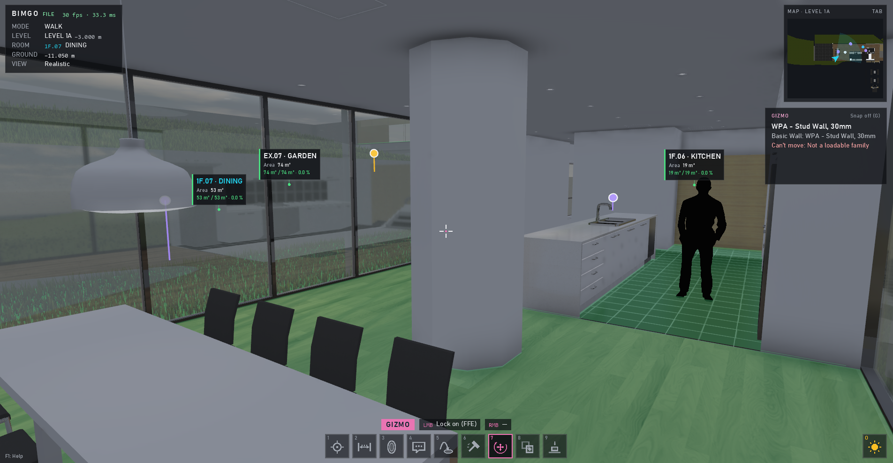
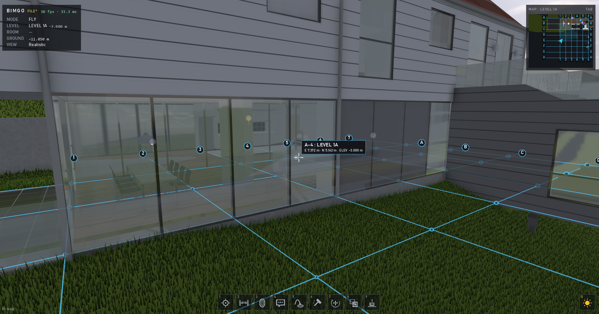

# Review tools

← [Docs home](README.md)

## Section box and cuts

**P** opens the section box editor: drag the face handles (Shift: no snapping), fit it to the level, a room or the
model, pick the cap colour. **Shift+P** cuts just behind the surface you aim at; **Ctrl+P** clears all cuts. Cuts are
saved with the model and in bookmarks, comments and BCF.

## Colour profiles

**Shift+C** shows the active colour profile; Esc → APPEARANCE tab → *Colour profiles* sets them up. Colour by a field
(category, family, type, level, phase, model) or any extracted Revit parameter, by number ranges, or by clash search
set; make the rest ghosted, normal or one colour; rows can be see-through or hidden. The legend can go into photos.

## Room data

**Shift+N** shows floating room tags with the parameters you pick (FIND ROOM → ROOM DATA), and can check a value
against a target (for example area against required area) in green, amber and red, with a floor tint.

## Grids and levels

**C** cycles grids off / on the level underfoot / all levels; **Shift+G** opens the grids panel (intersections,
bubbles, line style, colours).

## Hiding things

The Scan gun's **I** hides an element and **Shift+I** isolates its category; CATEGORIES & LINKS switches categories
and linked models; SHOW ALL brings everything back. This only changes the walkthrough, never Revit.
