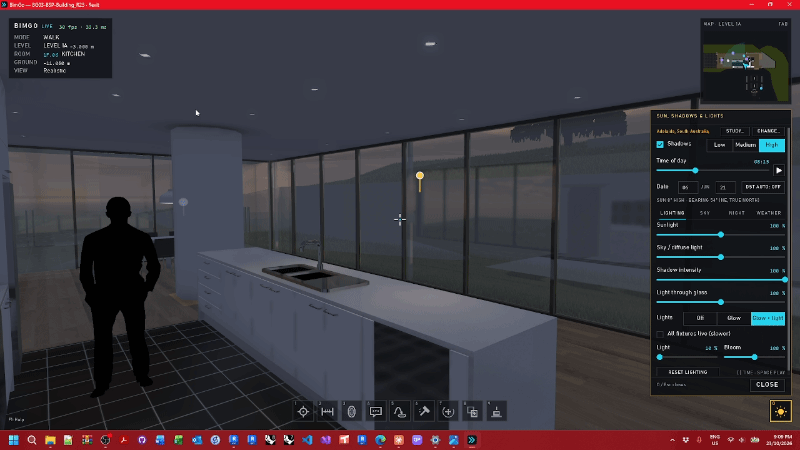
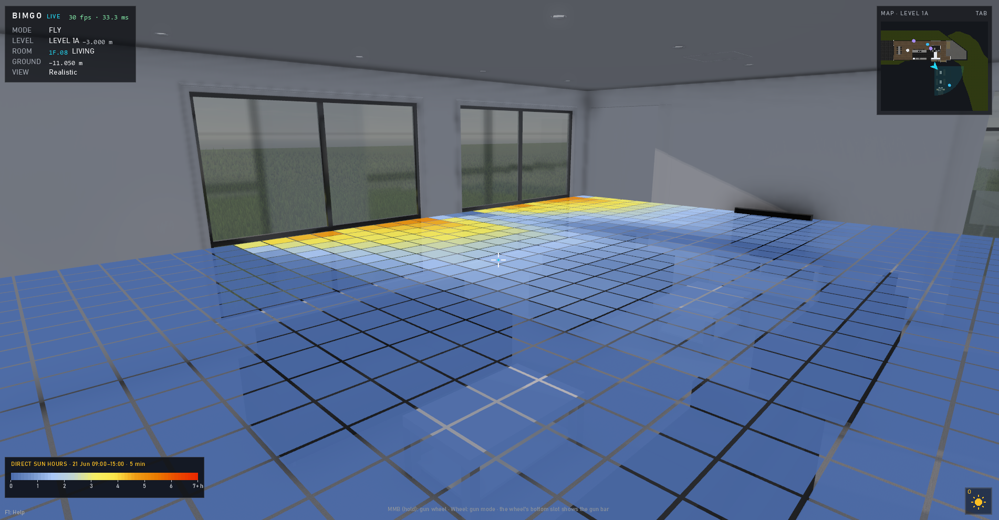
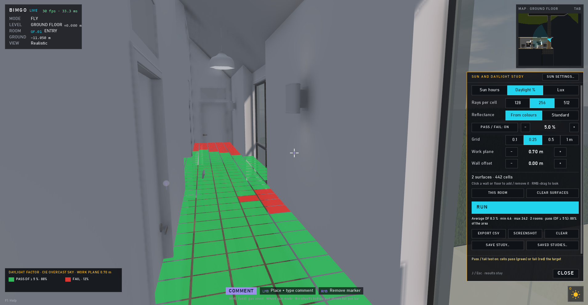

# Lighting, sun and studies

← [Docs home](README.md)

## Sun and shadows

**O** turns shadows on; **Shift+O** opens the sun panel: time of day, date, daylight saving, the balance of sunlight,
sky and shadows, clouds, night sky and weather. The site comes from Revit's location; **CHANGE…** can try another
place (an offline list of cities, or coordinates). **[** and **]** step the time.

**K** cycles artificial lights (lighting fixtures glow and light the room). Each fixture type can use its Revit
photometric file, a built-in profile or an imported `.ies` (Esc → the LIGHTS tab); Ctrl+K sets one fixture's own.

## Sun hours

**J** opens the study panel. Sun hours: the walls and floors of the room you stand in (click to add other surfaces)
get a grid of cells, and each is checked against the sun every few minutes over the day and time range you choose.
Results use the Ladybug 0–7 h colours, can pass / fail against a target, and export to CSV or a screenshot. Studies can
be saved and loaded again.

## Daylight factor and lux

The same panel's **Daylight %** and **Lux** modes work on a 0.7 m work plane over the room's floor (CIE overcast sky for
daylight factor; a clear sky plus direct sun for lux). These are early design indicators, not compliance calculations.

